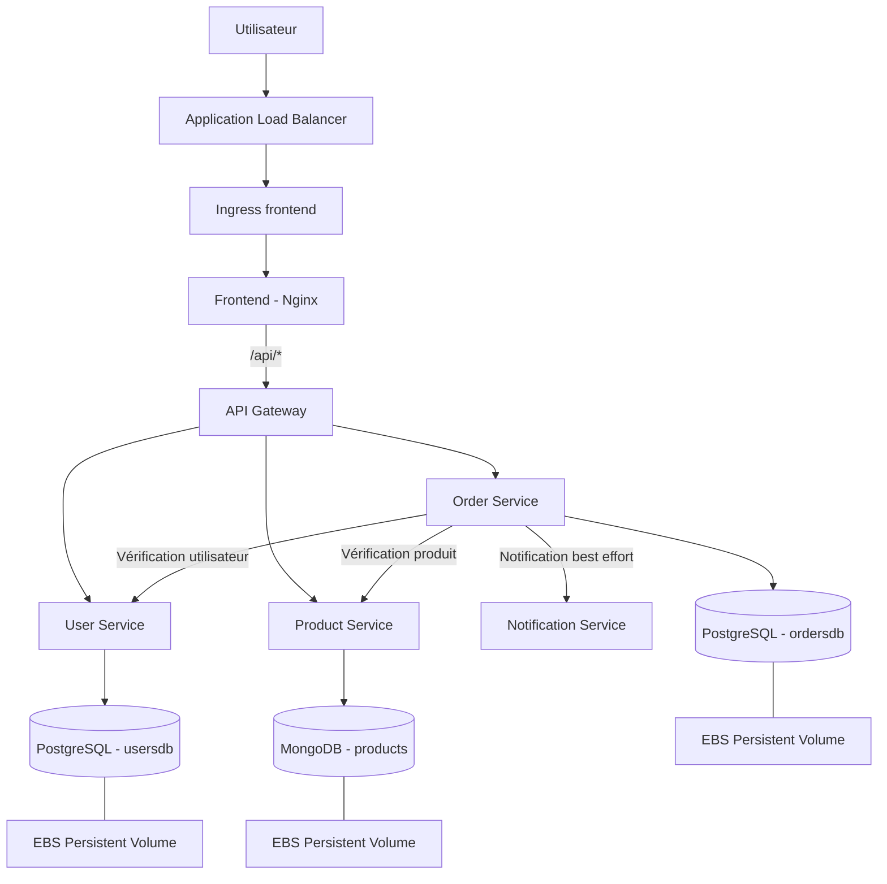

# Orchestration de microservices avec Amazon EKS et Helm

**Blueprint réutilisable de déploiement et d'orchestration d'applications microservices sur AWS**, basé sur Terraform, Amazon EKS et Helm.

Projet réalisé dans le cadre d'un Projet de Fin d'Année au sein de **Smartovate Ltd.**

---

## Présentation du projet

Ce projet consiste à concevoir et mettre en œuvre un blueprint réutilisable permettant de déployer une application composée de plusieurs microservices sur **Amazon Elastic Kubernetes Service (EKS)**.

L'infrastructure AWS est provisionnée avec **Terraform**, tandis que le déploiement applicatif repose sur **Helm**, à travers un chart parent regroupant plusieurs sous-charts.

Une application e-commerce est utilisée comme support de démonstration afin de vérifier les mécanismes d'orchestration, de persistance, de mise à l'échelle et de supervision.

Le projet explore également des mécanismes complémentaires tels que l'authentification IAM via IRSA, l'expérimentation GitOps avec ArgoCD et l'automatisation de la publication des images Docker.

### Objectifs

- Provisionner une infrastructure AWS reproductible avec Terraform.
- Déployer un cluster Amazon EKS réparti sur plusieurs zones de disponibilité.
- Organiser le déploiement des microservices avec une architecture Helm modulaire.
- Gérer les données persistantes avec des volumes EBS.
- Mettre en place la mise à l'échelle horizontale des pods.
- Intégrer des outils de supervision et de centralisation des logs.
- Explorer les mécanismes de résilience et d'automatisation des déploiements.

---

## Sommaire

- [Architecture](#architecture)
- [Stack technique](#stack-technique)
- [Structure du dépôt](#structure-du-dépôt)
- [Prérequis](#prérequis)
- [Déploiement](#déploiement)
- [Application de démonstration](#application-de-démonstration)
- [Tests et résultats](#tests-et-résultats)
- [Limites connues](#limites-connues)
- [Dépannage](#dépannage)
- [Sécurité et gestion des secrets](#sécurité-et-gestion-des-secrets)
- [Nettoyage des ressources](#nettoyage-des-ressources)
- [Auteure](#auteure)

---

## Architecture

### Architecture applicative

L'application de démonstration est composée de six microservices et de deux systèmes de stockage.



**Remarque :** l'Ingress est configuré pour exposer le frontend. Le routage des requêtes `/api/*` est ensuite effectué par Nginx vers l'API Gateway, qui distribue les appels aux services métier.

### Infrastructure AWS

L'infrastructure repose sur les composants suivants :

- Une VPC avec le CIDR `10.0.0.0/16`.
- Deux zones de disponibilité dans la région `eu-west-3` (Paris).
- Deux sous-réseaux publics et deux sous-réseaux privés.
- Une Internet Gateway et une NAT Gateway.
- Un cluster Amazon EKS.
- Un Managed Node Group composé de deux nœuds EC2 `t3.medium`.
- Des dépôts Amazon ECR pour les images des microservices.
- Des rôles IAM et des associations IRSA pour les composants Kubernetes nécessitant un accès aux services AWS.

Les nœuds EKS sont placés dans les sous-réseaux privés. Les composants de stockage utilisent le pilote EBS CSI pour gérer les volumes persistants.

---

## Stack technique

| Domaine | Technologies |
|---|---|
| Cloud | AWS : VPC, EKS, IAM, ECR, EC2, EBS, ALB, ACM |
| Infrastructure as Code | Terraform |
| Orchestration | Kubernetes, Amazon EKS |
| Packaging et déploiement | Helm |
| Conteneurisation | Docker, builds multi-stage |
| Registre d'images | Amazon ECR |
| Scalabilité | HPA, Cluster Autoscaler, Metrics Server |
| Stockage | Amazon EBS, EBS CSI Driver |
| Observabilité | Prometheus, Grafana, Alertmanager |
| Centralisation des logs | Fluent Bit, Amazon CloudWatch |
| Résilience | Circuit breaker avec Opossum |
| GitOps | ArgoCD |
| Automatisation | GitHub Actions, AWS OIDC, script Bash |
| Outils | AWS CLI, kubectl, Git, VS Code, WSL2 |

---

## Structure du dépôt

```text
.
├── ecommerce-app/                 # Application de démonstration
│   ├── frontend/                  # Interface web - Nginx
│   ├── api-gateway/               # API Gateway - Express
│   ├── user-service/              # Gestion des utilisateurs
│   ├── product-service/           # Gestion des produits
│   ├── order-service/             # Gestion des commandes
│   └── notification-service/      # Gestion des notifications
│
├── terraform/                     # Infrastructure AWS
│   └── modules/                   # Modules Terraform réutilisables
│
├── helm/
│   └── ecommerce-app/             # Chart Helm parent
│       ├── charts/                # Sous-charts
│       ├── values.yaml            # Configuration commune
│       ├── values-dev.yaml        # Configuration développement
│       ├── values-staging.yaml    # Configuration staging
│       ├── values-prod.yaml       # Configuration production
│       └── values-secrets.yaml.example
│
├── argocd/                        # Configuration ArgoCD
│
├── scripts/
│   └── push-to-ecr.sh             # Construction et publication des images
│
└── .github/
    └── workflows/                 # Workflow GitHub Actions préparé
```

---

## Prérequis

Avant de commencer, les outils suivants doivent être installés et configurés :

| Outil | Version / exigence |
|---|---|
| AWS CLI | Version récente |
| Terraform | ≥ 1.6 |
| kubectl | Compatible avec la version du cluster EKS |
| Helm | ≥ 3 |
| Docker | Version récente |
| Git | Version récente |

Il faut également disposer :

- D'un compte AWS avec les autorisations nécessaires pour créer les ressources utilisées par Terraform.
- D'un accès aux services EKS, EC2, IAM, ECR et VPC.
- D'une authentification AWS fonctionnelle, par exemple via AWS SSO.

**Attention aux coûts :** Amazon EKS, les instances EC2, les volumes EBS et la NAT Gateway peuvent générer des frais. Il est recommandé de supprimer les ressources inutilisées après les sessions de travail.

---

## Déploiement

Les étapes suivantes décrivent le processus de déploiement du blueprint.

### 1. Récupérer le dépôt

```bash
git clone https://github.com/khaoula-dr/Orchestration-EKS.git
cd Orchestration-EKS
```

### 2. Provisionner l'infrastructure AWS

```bash
cd terraform

cp terraform.tfvars.example terraform.tfvars
```

Renseigner les variables nécessaires dans `terraform.tfvars`, notamment les paramètres liés au projet et au dépôt GitHub si le module OIDC est utilisé.

Initialiser et vérifier la configuration Terraform :

```bash
terraform init
terraform validate
terraform plan
```

Provisionner les ressources :

```bash
terraform apply
```

Vérifier les sorties Terraform et conserver les informations nécessaires pour les étapes suivantes.

### 3. Configurer l'accès au cluster EKS

Depuis le terminal :

```bash
aws eks update-kubeconfig \
  --region eu-west-3 \
  --name ecommerce-eks
```

Vérifier la connexion :

```bash
kubectl get nodes -o wide
kubectl get namespaces
```

Le cluster de démonstration utilisé comporte deux nœuds répartis sur deux zones de disponibilité.

### 4. Construire et publier les images Docker

Depuis la racine du dépôt :

```bash
export AWS_REGION=eu-west-3

chmod +x scripts/push-to-ecr.sh

./scripts/push-to-ecr.sh $(date +%Y%m%d-%H%M%S)
```

Le script automatise la construction des images et leur publication dans les dépôts Amazon ECR provisionnés par Terraform.

**Important :** les dépôts ECR utilisent une politique de tags immuables. Chaque publication doit donc utiliser un tag unique.

Conserver le tag généré pour configurer les références des images dans Helm.

### 5. Préparer les valeurs Helm locales

```bash
cd helm/ecommerce-app

cp values-secrets.yaml.example values-secrets.yaml
```

Renseigner les valeurs propres à l'environnement :

- Identifiant du compte AWS.
- Région AWS.
- Références des images ECR.
- Tags des images.
- Paramètres sensibles nécessaires à la démonstration.

Le fichier `values-secrets.yaml` ne doit pas être versionné dans Git.

### 6. Vérifier et déployer l'application

Mettre à jour les dépendances Helm :

```bash
helm dependency update
```

Vérifier le chart :

```bash
helm lint .
helm template ecommerce-app .
```

Créer le namespace :

```bash
kubectl create namespace demo-app
```

Installer l'application :

```bash
helm install ecommerce-app . \
  -n demo-app \
  -f values.yaml \
  -f values-secrets.yaml \
  -f values-dev.yaml
```

Vérifier les ressources :

```bash
kubectl get deployments -n demo-app
kubectl get statefulsets -n demo-app
kubectl get pods -n demo-app
kubectl get services -n demo-app
kubectl get pvc -n demo-app
```

Le chart parent regroupe huit composants : six microservices et deux bases de données.

### 7. Accéder à l'application

L'accès utilisé pour les tests fonctionnels repose sur `kubectl port-forward`.

```bash
kubectl port-forward \
  -n demo-app \
  svc/frontend \
  8080:80
```

Ouvrir ensuite :

```text
http://localhost:8080
```

Cette méthode permet d'accéder à l'interface sans dépendre de l'exposition publique par ALB.

**Note :** l'exposition externe via ALB et la validation TLS de bout en bout ne sont pas validées dans cette version du projet.

---

## Application de démonstration

L'application e-commerce sert de support à la validation du blueprint d'orchestration.

### Microservices

| Service | Responsabilité | Stockage |
|---|---|---|
| `frontend` | Interface web statique | Aucun |
| `api-gateway` | Routage des requêtes vers les services métier | Aucun |
| `user-service` | Gestion des utilisateurs | PostgreSQL |
| `product-service` | Gestion des produits | MongoDB |
| `order-service` | Orchestration de la création des commandes | PostgreSQL |
| `notification-service` | Gestion des notifications | Mémoire |

### Bases de données

- **PostgreSQL** : contient les bases `usersdb` et `ordersdb`.
- **MongoDB** : contient les données des produits dans la collection `products`.

Les bases de données sont déployées avec des StatefulSets et utilisent des volumes persistants EBS.

### Flux de création d'une commande

Le scénario métier prévu pour la création d'une commande est le suivant :

1. Le frontend transmet la requête à l'API Gateway.
2. L'API Gateway route la requête vers `order-service`.
3. `order-service` vérifie l'existence de l'utilisateur auprès de `user-service`.
4. Il vérifie ensuite le produit auprès de `product-service`.
5. Si les vérifications réussissent, la commande est enregistrée dans PostgreSQL.
6. Une notification est envoyée à `notification-service`.

Les appels inter-services sont protégés par un mécanisme de circuit breaker basé sur Opossum. Le délai d'attente configuré est de 3 secondes. La notification utilise un mécanisme de fallback afin que son indisponibilité ne bloque pas le traitement de la commande.

**État de validation :** le circuit breaker a été testé isolément en local. Le fonctionnement complet de `order-service` n'a pas été stabilisé sur le cluster EKS ; ce scénario métier n'est donc pas considéré comme validé de bout en bout sur le cluster.

---

## Tests et résultats

Les tests ont porté sur le provisionnement de l'infrastructure, le déploiement Kubernetes, la persistance, la scalabilité et les mécanismes complémentaires.

| Test | Résultat |
|---|---|
| Provisionnement VPC, EKS, IAM et ECR | <span>Réussi</span> |
| Cluster EKS avec deux nœuds sur deux AZ | Réussi |
| Déploiement Helm des huit composants | Réussi |
| Persistance après suppression du pod PostgreSQL | Réussi |
| HPA sous charge : passage de 2 à 3 replicas | Réussi |
| Cluster Autoscaler : évaluation du scale-down | Partiellement validé |
| Circuit breaker Opossum | Validé en local uniquement |
| ArgoCD : synchronisation manuelle | Réussie |
| Exposition externe via ALB | Non validée |
| TLS de bout en bout | Non validé |
| Network Policies | Générées et vérifiées syntaxiquement, puis désactivées après incident |
| Pipeline GitHub Actions | Préparé, non exécuté en conditions réelles |
| Prometheus, Grafana, Alertmanager et Fluent Bit | Installés et testés |
| Tracing distribué avec Jaeger / OpenTelemetry | Non finalisé |

### Test de mise à l'échelle HPA

Une charge a été générée sur l'API Gateway afin de vérifier le comportement de l'Horizontal Pod Autoscaler.

Le nombre de réplicas est passé automatiquement de deux à trois lorsque l'utilisation CPU a dépassé le seuil configuré de 70 %.

### Test de persistance

Après la création d'un utilisateur, le pod `postgres-0` a été supprimé volontairement. Après son redémarrage, les données précédemment enregistrées étaient toujours présentes.

Ce test confirme la persistance des données à travers le cycle de vie du pod.

---

## Limites connues

Certaines fonctionnalités n'ont pas pu être validées complètement pendant la réalisation du projet.

### Exposition externe et TLS

Le contrôleur AWS Load Balancer Controller n'a pas réussi à provisionner l'ALB associé à l'Ingress. Des erreurs de découverte des sous-réseaux et de configuration du VPC ont été rencontrées.

En conséquence, les tests fonctionnels ont été réalisés avec `kubectl port-forward`. Le certificat TLS auto-signé configuré dans ACM n'a pas pu être validé de bout en bout.

### Stabilité de `order-service`

Le service est resté en état `CrashLoopBackOff` sur le cluster EKS. Le circuit breaker a donc été validé en local, sans validation complète de ce mécanisme dans l'environnement Kubernetes.

### Network Policies

Les politiques réseau ont été générées et validées syntaxiquement. Leur activation a toutefois bloqué certains flux sortants, notamment la communication nécessaire au fonctionnement de l'application. Elles ont été désactivées après cet incident.

### Automatisation CI/CD et GitOps

Le workflow GitHub Actions de construction, de scan Trivy et de publication ECR a été préparé, mais n'a pas été exécuté en conditions réelles. La publication a été réalisée avec le script Bash.

ArgoCD a permis de valider une synchronisation manuelle de l'application. La synchronisation automatique déclenchée par un commit n'a pas été démontrée.

### Autres limites

- Les tests unitaires automatisés ne sont pas finalisés.
- Le scale-up réel du Cluster Autoscaler n'a pas été testé.
- Le tracing distribué avec Jaeger / OpenTelemetry a été abandonné.
- Une seule NAT Gateway est utilisée pour limiter les coûts, ce qui constitue un point de défaillance unique.

Ces limites doivent être prises en compte avant toute réutilisation du blueprint dans un environnement de production.

---

## Dépannage

| Symptôme | Cause possible | Solution / vérification |
|---|---|---|
| `terraform destroy` échoue avec `DependencyViolation` | Ressources AWS encore attachées au VPC | Identifier les dépendances, notamment les ressources créées automatiquement par GuardDuty |
| `RepositoryNotEmptyException` | Dépôt ECR contenant des images | Supprimer les images avant de détruire le dépôt |
| Pods en `Pending` avec `Too many pods` | Limite de capacité du plugin réseau AWS VPC CNI | Vérifier les ressources et le nombre maximal de pods par nœud |
| `ImagePullBackOff` | Image ou tag absent d'ECR | Vérifier les images publiées et les valeurs Helm |
| PostgreSQL en `CrashLoopBackOff` avec `lost+found` | Répertoire de données non vide à la racine du volume | Utiliser un sous-répertoire dédié avec `PGDATA` |
| Erreurs npm ou fichiers `node_modules` corrompus | Installation sur un chemin Windows monté dans WSL | Travailler depuis le système de fichiers Linux natif, par exemple `~/` |
| `Metrics API not available` | Metrics Server absent ou non opérationnel | Vérifier le déploiement et les logs de Metrics Server |
| Ingress sans adresse ALB | Configuration des sous-réseaux ou du contrôleur | Vérifier les annotations, les paramètres VPC et les logs du contrôleur |

**Attention :** le compte AWS utilisé pendant le projet étant partagé, vérifier l'origine des ressources, notamment avec AWS CloudTrail, avant toute suppression manuelle.

---

## Sécurité et gestion des secrets

Les principes suivants ont été appliqués ou prévus dans le projet :

- **IRSA** : association des ServiceAccounts Kubernetes à des rôles IAM dédiés pour limiter les permissions des composants AWS.
- **OIDC** : configuration de l'authentification fédérée prévue pour GitHub Actions, sans stockage de clés AWS statiques dans le dépôt.
- **Fichiers sensibles** : `terraform.tfvars` et `values-secrets.yaml` sont exclus du versionnement.
- **Exemples de configuration** : seuls les fichiers modèles `*.example` sont versionnés.
- **ArgoCD** : les fichiers de secrets locaux ne sont pas inclus dans la configuration GitOps.
- **Mots de passe de démonstration** : les valeurs utilisées dans l'environnement de test doivent être remplacées par un gestionnaire de secrets adapté avant toute mise en production.

---

## Nettoyage des ressources

Pour éviter des frais AWS inutiles, supprimer les ressources après utilisation.

### 1. Désinstaller l'application

```bash
helm uninstall ecommerce-app -n demo-app
```

### 2. Supprimer les volumes persistants

Vérifier les PVC avant leur suppression :

```bash
kubectl get pvc -n demo-app
kubectl delete pvc --all -n demo-app
```

Attendre la libération des volumes avant de poursuivre.

### 3. Détruire l'infrastructure Terraform

```bash
cd terraform
terraform destroy
```

Vérifier que les ressources AWS ont bien été supprimées.

**Important :** ne pas supprimer manuellement une ressource AWS sans avoir vérifié qu'elle appartient bien à ce projet, en particulier dans le contexte d'un compte partagé.

---

## Auteure

**Khaoula Driouich**  
Filière : Réseaux, Systèmes et Services Programmables

Projet réalisé au sein de **Smartovate Ltd.**

Encadrant professionnel : **Abdelkhalek Bakkari**

---

## Licence

Projet académique réalisé dans le cadre d'un Projet de Fin d'Année.
