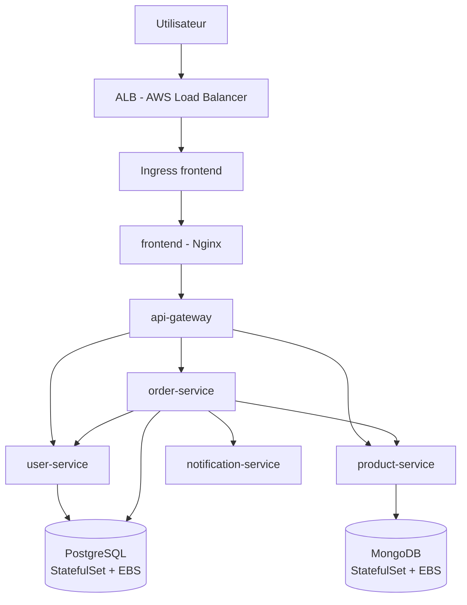

# Orchestration Microservices avec Amazon EKS + Helm

Blueprint de déploiement d'une application microservices sur **Amazon EKS**, avec une infrastructure décrite en **Terraform**, un packaging **Helm** (chart parent + sous-charts) et une expérimentation **GitOps** avec **ArgoCD**.

Projet réalisé dans le cadre d'un Projet de Fin d'Année (ENSAM) au sein de **Smartovate Ltd.**

---

## Sommaire

- [Architecture](#architecture)
- [Stack technique](#stack-technique)
- [Structure du dépôt](#structure-du-dépôt)
- [Prérequis](#prérequis)
- [Déploiement](#déploiement)
- [Application de démonstration](#application-de-démonstration)
- [Résultats des tests](#résultats-des-tests)
- [Limites connues](#limites-connues)
- [Dépannage](#dépannage)
- [Sécurité et secrets](#sécurité-et-secrets)

---

## Architecture



**Infrastructure AWS** (`eu-west-3`) :

- 1 VPC (`10.0.0.0/16`) réparti sur **2 zones de disponibilité**
- 2 sous-réseaux publics (ALB, NAT Gateway) et 2 sous-réseaux privés (nœuds EKS)
- Cluster EKS avec un Managed Node Group (`t3.medium`)
- Authentification des composants via **IRSA** (pas de clés AWS statiques)

---

## Stack technique

| Domaine | Outils |
|---|---|
| Cloud | AWS (VPC, EKS, IAM, ECR, ALB, EBS, ACM) |
| Infrastructure as Code | Terraform (modules : `vpc`, `iam`, `ecr`, `eks`, `github-oidc`, `alb-controller-irsa`, `cluster-autoscaler-irsa`, `ebs-csi-irsa`, `fluent-bit-irsa`, `acm-self-signed`) |
| Orchestration | Kubernetes (EKS), Helm |
| Conteneurisation | Docker (builds multi-stage), Amazon ECR |
| Scalabilité | HPA, Cluster Autoscaler, Metrics Server |
| Observabilité | Prometheus, Grafana, Alertmanager, Fluent Bit |
| Résilience | Circuit breaker ([Opossum](https://github.com/nodeshift/opossum)) |
| GitOps / CI | ArgoCD, GitHub Actions (build, scan Trivy, push ECR) |

---

## Structure du dépôt

```text
.
├── ecommerce-app/          # Application de démonstration (6 microservices)
│   ├── frontend/           # Nginx
│   ├── api-gateway/        # Express - reverse proxy
│   ├── user-service/       # Express + PostgreSQL
│   ├── product-service/    # Express + MongoDB
│   ├── order-service/      # Express + PostgreSQL + circuit breaker
│   └── notification-service/
├── terraform/              # Infrastructure AWS (modules réutilisables)
├── helm/ecommerce-app/     # Chart parent + 8 sous-charts
│   ├── values.yaml
│   ├── values-dev.yaml / values-staging.yaml / values-prod.yaml
│   └── values-secrets.yaml.example
├── argocd/                 # Manifest Application ArgoCD
├── scripts/
│   └── push-to-ecr.sh      # Build + push des images vers ECR
└── .github/workflows/      # Pipeline CI (build, scan, push)
```

---

## Prérequis

- Compte AWS avec droits suffisants (IAM, EKS, EC2, ECR)
- [AWS CLI](https://docs.aws.amazon.com/cli/) configuré (`aws sso login` ou `aws configure`)
- [Terraform](https://developer.hashicorp.com/terraform) ≥ 1.6
- [kubectl](https://kubernetes.io/docs/tasks/tools/)
- [Helm](https://helm.sh/) ≥ 3
- [Docker](https://www.docker.com/)

> **Coût** : un cluster EKS, un NAT Gateway et des instances EC2 sont facturés à l'heure. Pensez à lancer `terraform destroy` après chaque session.

---

## Déploiement

### 1. Provisionner l'infrastructure

```bash
cd terraform
cp terraform.tfvars.example terraform.tfvars   # renseigner github_org / github_repo
terraform init
terraform plan
terraform apply
```

### 2. Se connecter au cluster

```bash
aws eks update-kubeconfig --region eu-west-3 --name ecommerce-eks
kubectl get nodes
```

### 3. Publier les images dans ECR

```bash
export AWS_REGION=eu-west-3
./scripts/push-to-ecr.sh $(date +%Y%m%d-%H%M%S)
```

> Les dépôts ECR sont en tags **immutables** : chaque build doit utiliser un tag unique. Notez le tag affiché, il sera à renseigner dans `values-secrets.yaml`.

### 4. Configurer les valeurs locales (non commitées)

```bash
cd helm/ecommerce-app
cp values-secrets.yaml.example values-secrets.yaml
# remplacer <AWS_ACCOUNT_ID> et les tags d'images par vos valeurs
```

### 5. Déployer l'application

```bash
helm dependency update
helm lint .

kubectl create namespace demo-app
helm install ecommerce-app . -n demo-app \
  -f values.yaml -f values-secrets.yaml -f values-dev.yaml

kubectl get pods -n demo-app
kubectl get pvc -n demo-app
```

Changer d'environnement : remplacer `values-dev.yaml` par `values-staging.yaml` ou `values-prod.yaml`.

### 6. Accéder à l'application

```bash
kubectl port-forward -n demo-app svc/frontend 8080:80
```

Puis ouvrir <http://localhost:8080>.

### 7. Nettoyer

```bash
helm uninstall ecommerce-app -n demo-app
kubectl delete pvc --all -n demo-app
cd terraform && terraform destroy
```

---

## Application de démonstration

| Service | Rôle | Persistance |
|---|---|---|
| `frontend` | Interface web statique (Nginx) | — |
| `api-gateway` | Routage `/api/*` vers les services métier | — |
| `user-service` | Gestion des utilisateurs | PostgreSQL (`usersdb`) |
| `product-service` | Gestion des produits | MongoDB (`products`) |
| `order-service` | Création des commandes, orchestration des appels | PostgreSQL (`ordersdb`) |
| `notification-service` | Notifications | Mémoire |

Tous les services Node.js exposent `GET /health` (utilisé par les sondes `startup`, `liveness` et `readiness`).

Exemple de flux : `POST /api/orders` → `order-service` vérifie l'utilisateur et le produit (via circuit breaker, timeout 3 s), enregistre la commande, puis notifie `notification-service` en *best effort*.

---

## Résultats des tests

| Test | Résultat |
|---|---|
| Provisionnement de l'infrastructure (VPC, EKS, IAM, ECR) | Réussi |
| Déploiement Helm complet (8 composants) | Réussi |
| Communication inter-services | Réussi |
| Persistance des données (suppression du pod `postgres-0`) | Réussi |
| HPA sous charge (scale-up 2 → 3 pods à 91 % CPU, seuil 70 %) | Réussi |
| Cluster Autoscaler (évaluation des seuils de scale-down) | Réussi (scale-up réel non testé) |
| ArgoCD (`Status: Synced` sur ce dépôt) | Réussi (synchronisation manuelle) |
| Circuit breaker | Réussi en local, non validé sur le cluster |
| Exposition via ALB + TLS | Non validé |
| Network Policies | Code validé, désactivées après incident |
| Pipeline GitHub Actions | Codé, non exécuté (script manuel utilisé) |
| Tracing distribué (Jaeger / OpenTelemetry) | Abandonné |

---

## Limites connues

- **ALB / TLS** : le contrôleur AWS Load Balancer n'a jamais obtenu d'adresse pour l'Ingress (erreurs `couldn't auto-discover subnets` puis `InvalidParameterValue: vpc-id`). Les tests ont été faits via `kubectl port-forward`.
- **`order-service`** : reste en `CrashLoopBackOff` sur le cluster (dépendance `opossum` incompatible et corruption de `node_modules` constatée sur un chemin WSL `/mnt/c/`). Le circuit breaker reste validé en local.
- **Network Policies** : les fichiers `templates/networkpolicy-*.yaml.disabled` ne sont pas appliqués. La règle `allow-dns-egress` bloquait tout le trafic sortant des pods (une policy `Egress` refuse tout ce qui n'est pas explicitement autorisé).
- **Tests unitaires** : non implémentés (nécessiteraient de séparer `app.js` et `server.js` dans chaque service).
- Une seule NAT Gateway est utilisée pour limiter les coûts (point de défaillance unique, à éviter en production).
- Le certificat TLS est auto-signé (pas de nom de domaine disponible).

---

## Dépannage

| Symptôme | Cause probable | Piste |
|---|---|---|
| `terraform destroy` bloque sur les sous-réseaux (`DependencyViolation`) | Ressources créées par GuardDuty (security group + VPC endpoint) | Supprimer d'abord le VPC endpoint, attendre la libération des ENI, puis le security group |
| `terraform destroy` bloque sur ECR (`RepositoryNotEmptyException`) | Dépôts non vides (tags immutables) | Vider les images avec `aws ecr batch-delete-image` (2 passes) |
| Pods en `Pending` (`Too many pods`) | Limite d'adresses IP par instance (VPC CNI) | Réduire les replicas, désinstaller les outils d'observabilité, ou augmenter le nombre de nœuds |
| `ImagePullBackOff` | Image absente d'ECR ou tag erroné | Vérifier `aws ecr list-images` et les tags dans `values-secrets.yaml` |
| `postgres-0` en `CrashLoopBackOff` (`directory ... is not empty`) | Dossier `lost+found` à la racine du volume EBS | Définir `PGDATA=/var/lib/postgresql/data/pgdata` (déjà fait dans le chart) |
| Erreur `npm` / JSON corrompu dans `node_modules` | `npm install` sur un chemin Windows monté (`/mnt/c/`) | Travailler depuis le système de fichiers Linux (`~/`) |
| `Metrics API not available` | Metrics Server non installé | Installer `metrics-server` (avec `--kubelet-insecure-tls` sur EKS) |

> Le compte AWS utilisé étant partagé, vérifier l'origine d'une ressource (par exemple avec AWS CloudTrail) avant toute suppression manuelle.

---

## Sécurité et secrets

- Aucune clé AWS n'est stockée : les composants utilisent **IRSA**, et GitHub Actions s'authentifie via **OIDC**.
- `terraform.tfvars` et `values-secrets.yaml` sont exclus du dépôt (`.gitignore`) ; seuls les fichiers `*.example` sont versionnés.
- ArgoCD ne lit que `values.yaml` et `values-<env>.yaml`, jamais `values-secrets.yaml`.
- Les mots de passe de base de données présents dans les `values.yaml` sont des valeurs de démonstration. Ils doivent être remplacés par un gestionnaire de secrets en production.

---
